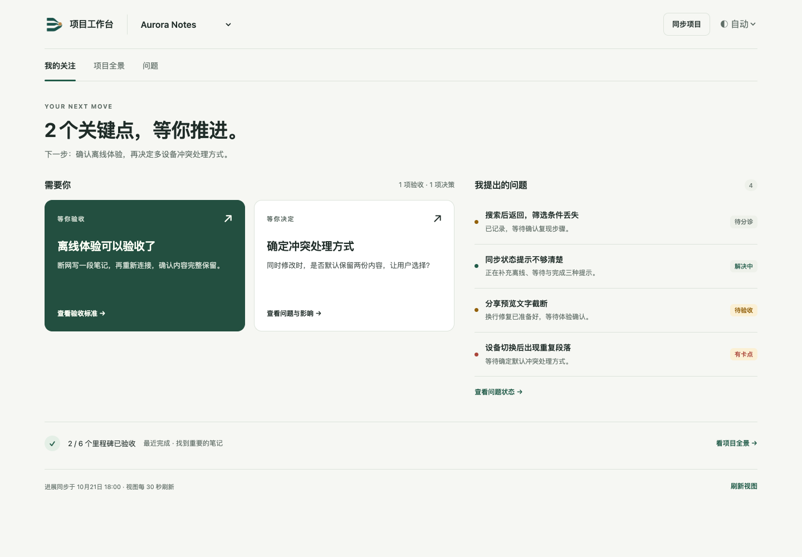
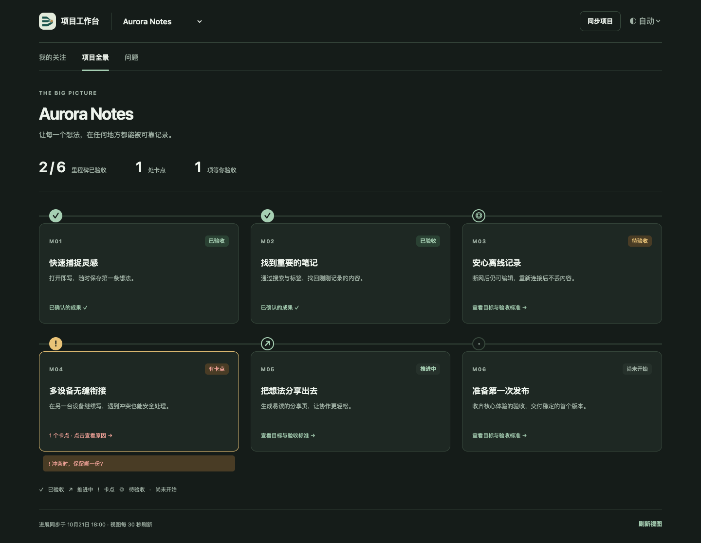

# Project Desk · 项目工作台

A focused Codex desktop plugin for **your acceptance, project milestones, and the issues you reported**.

项目很多，但真正需要你关注的，应该一眼就能看到。

- **我的关注**：突出待验收、待决策；只展示用户提出的未关闭问题，隐藏 Agent 自行拆出的实现任务。
- **项目全景**：里程碑航线标出已验收成果、当前进展和卡点。点击卡点，查看原因、影响、下一步和负责聊天。
- **问题**：区分待分诊、解决中、有卡点、待验收、已解决；可切换“我提出的”和“全部”。
- **任意 Codex 项目**：从宿主可访问的项目目录中选择本地、远程或 ChatGPT 项目。同步技能仅整理所选项目的聊天证据。
- **自动主题**：优先跟随宿主，未提供时跟随系统；也可手动选浅色或深色。支持移动端、键盘和减少动态效果偏好。

The public sample is fictional. There is no bundled private project data, repository adapter, transcript, credential, or machine-specific configuration.

## Preview

Screenshots below use fictional Aurora Notes data in a real browser, not a connected Codex installation.





## Run locally

Use Node.js 22.18+ or a newer supported Node release. The packaged server needs only Node; source development also needs npm.

```sh
npm ci
npm run check
npm run check:docs
npm run preview
python3 -m http.server 43871 --bind 127.0.0.1 --directory output/preview
```

Open the local address printed by the server, then select **Aurora Notes**. This demo never connects to Codex or opens real chats. Its host bridge records requested actions in memory for testing.

For the real plugin, follow [installation](INSTALL.md), then click **连接项目**, select a project and click **同步项目**. Hosts must expose project listing and chat reading tools, MCP Apps UI, and the current-chat message bridge. When the message bridge is unavailable, the UI provides a copyable sync prompt. Host availability differs; generic MCP clients can use the projection tools but cannot discover Codex projects by themselves.

## How updates work

The host model uses the bundled [project-desk skill](skills/project-desk/SKILL.md) to read the selected project's chats and write a compact local projection. This is a summary of evidence, not a second task authority. Catalog discovery reads project metadata; selecting a project does not read every project's chats.

The visible UI refreshes its stored projection every 30 seconds and pauses when hidden. **Refreshing the view does not rescan chats.** Click **同步项目** to request a fresh evidence review in the current chat. The footer shows when project progress was last synced. Navigation opens a responsible chat; it does not send a message there.

Acceptance requires dated user acceptance evidence. A code fix waiting for verification remains “待验收”; it is not silently marked resolved. Unknown state and incomplete source coverage remain visible in the projection. Sync quality depends on the host's evidence review and accessible chat history.

See [permissions and data](PERMISSIONS.md), [reader updates](HOT-UPDATE.md), [design choices](docs/design.md), and [verification](docs/verification.md).

## Development

The UI is TypeScript and DOM/CSS with no frontend framework or external font/CDN. MCP uses the official SDK and MCP Apps bridge. The store validates typed documents, uses revision checks and atomic replacement, and keeps recovery history outside the source tree. The pure projection engine can be replaced independently of the running stdio broker.

```sh
npm run build
npm run pack
```

Packaging uses tracked source files plus the self-contained build. It produces a ZIP and hash manifest under `output/package/`. It does not install, publish a marketplace entry, or restart the host.

Public source availability is not a license grant. No project license has been selected. Bundled dependencies retain their own notices in `dist/THIRD-PARTY-NOTICES.txt` after building.
