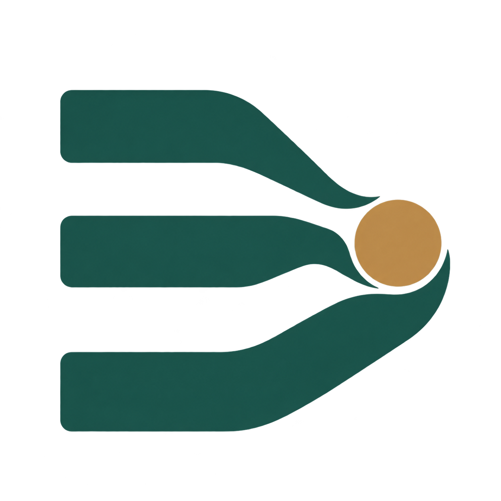

# Project Desk icon

Three converging paths meet at an amber decision point. The transparent symbol is shared by the plugin manifest and UI.

The 1254 × 1254 RGBA image was generated with the built-in image generation tool. It is a raster illustration with slight color variation, not a vector asset. [Generation prompts](icon-generation.json) document its origin.

Icon or manifest changes require a full plugin update. Reader engine hot updates do not replace the host's loaded UI or entrypoint icon.

The plugin listing uses `logo`/`composerIcon`. Sidebar and chat entrypoints discover the same PNG through the MCP server implementation `icons` field, which the host uses when the entrypoint tool has no icon. The build embeds a data URI so local paths are never sent to the host and the packaged server needs no asset-file access.
